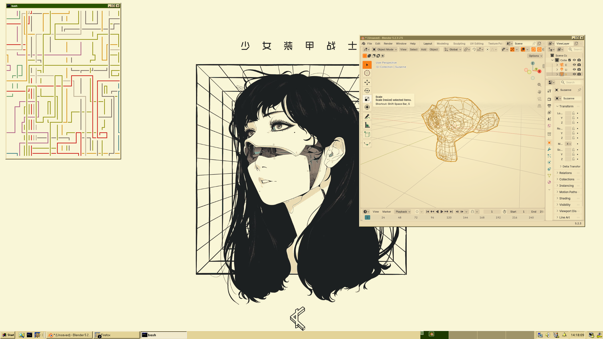

<div class="center">
    <h1>Dotfiles</h1>
    
</div>
This is a collection of my personal dotfiles along with some tweaks I did for my `EndeavourOS Linux Setup`. 

## Where to copy the files
Copy the following directories into your `~/.config` folder:
* `bat`
* `nvim`
* `kitty`

Copy the `.bashrc` file in your `$HOME` folder.
Copy the `Chicago95-Dune` folder into `~/.themes/`.
Copy the `sddm/Chicago95-Dune` folder into `/usr/share/sddm/themes/`.

## Chicago95 Theme
The general look and feel of my system comes from the `Chicago95` theme which can be found [here](https://github.com/grassmunk/chicago95). General instructions of how to set this theme up can be found [here](https://github.com/grassmunk/Chicago95/blob/master/INSTALL.md).
I use a slightly modified version of the `Chicago95` Theme called `Chicago95-Dune` which can be found [here](https://github.com/A-Harmless-Fly/Chicago95-Dune).

> :warning: You should run the default installation script of the original `Chicago95` theme first before copy over the `Chicago95-Dune` folder to the `~/.themes`directory.

## Useful Command Line Tools
Here's a list of command line tools I use on a daily basis:
* [bat](https://github.com/sharkdp/bat)
* [zoxide](https://github.com/ajeetdsouza/zoxide)

## Useful Software and Libraries
* [raddebugger](https://github.com/EpicGames/raddebugger)
* [gf2](https://github.com/nakst/gf)
* [RenderDoc](https://renderdoc.org/)
* [Raylib](https://www.raylib.com/)

## Wallpaper
The wallpaper can be found [here](https://gruvbox-wallpapers.pages.dev/wallpapers/minimalistic/light/ALLqk82.jpg).

## Kitty
I am using the `Jetbrains Mono Nerd Font`. In order to install it use the following command `pacman -S ttf-jetbrains-mono-nerd`. Other then that I am using the `Gruvbox Light` colorscheme:
* [Gruvbox Colorscheme](https://github.com/wdomitrz/kitty_gruvbox_theme).

## Neovim
For a general guide on getting started I highly recommend this video from [ThePrimeagen](https://www.youtube.com/watch?v=w7i4amO_zaE).
In general I use the default `built-in package manager` from Neovim:
* [Gruvbox Colorscheme](https://gitlab.com/motaz-shokry/gruvbox.nvim)

## Get rid of Boot Selection
* Edit the file `/efi/loader/loader.conf` and set the `timeout` to `0`:
```bash
...
timeout 0
...
```
## Plymouth Boot Screen
In order to get the Boot Screen to work properly we first need to install `plymouth` and then set the corresponding theme:
* In order to install `plymouth` run the following command `sudo pacman -S plymouth`
* Next navigate into `/etc/plymouth` and edit the `plymouth.conf` file:
```bash
[Daemon]
Theme=Chicago95
...
```
* As a next step we need to make `dracut` aware of `plymouth`. In order to do this navigate into the `/etc/dracut.conf.d` directory and create a `plymouth.conf` file with the following content:
```bash
add_dracutmodules+=" plymouth "
```
* After this change dracut needs to be update with the following command `sudo dracut --force`
* Next we need to add the necessary `kernel parameters` for plymouth to show up. For that navigate into `/etc/kernel` and add the following line to the `cmdfile` file:
```bash
kernel_cmdline+=" splash quiet "
```
* For the changes to take effect run the `sudo reinstall-kernels` command
* As a last step copy over the `Chicago95 Plymouth` theme (can be found in the official git repo [here](https://github.com/grassmunk/chicago95)) to `/usr/share/plymouth/themes/` folder

## SDDM Login Manager
> :warning: Important: In order for the theme to function correctly make sure you have the `qt5-quickcontrols` and `qt5-quickcontrols2` installed.

By default `Endeavour OS` uses the `lightdm` login manager. It is recommended to switch to the `sddm` login manager instead:
* Open the `Welcome` Utility Application in `Endeavour OS` and click `Change Display Manager`
* Switch from `lightdm` to `sddm`

Then we need to add a default config for `sddm` and also set `Chicago95` as our main theme:
* Create a `sddm.conf.d` directory under `/etc` and navigate into it
* Afterwards create a default config file with the following command `sddm --example-config > sddm.conf`
* As a last step copy over the `sddm/Chicago95-Dune` folder to `/usr/share/sddm/themes`. Note that this is a version of the original `Chicago95` sddm theme where I tweaked some colors to better match the `Chicago95-Dune` theme. The original version can be found [here](https://github.com/grassmunk/Chicago95/tree/master/KDE/SDDM/Chicago95).
* Finally set the theme to `Chicago95-Dune`. For this set the `Current` entry under the `[Theme]` section:
```bash
...
[Theme]
Current=Chicago95-Dune
...
```
* In case you want to test the theme first you can simply run the following command `sddm-greeter-qt6 --test-mode --theme <path_to-theme>`
